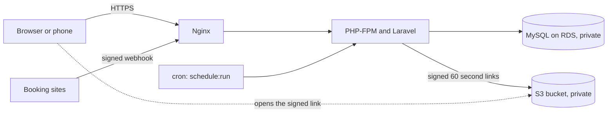
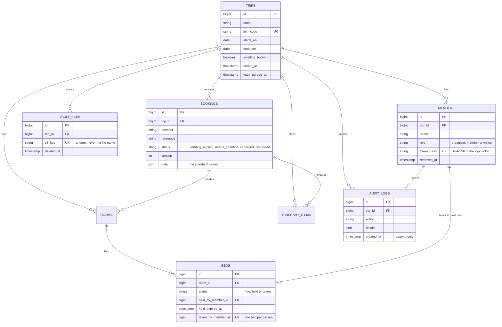
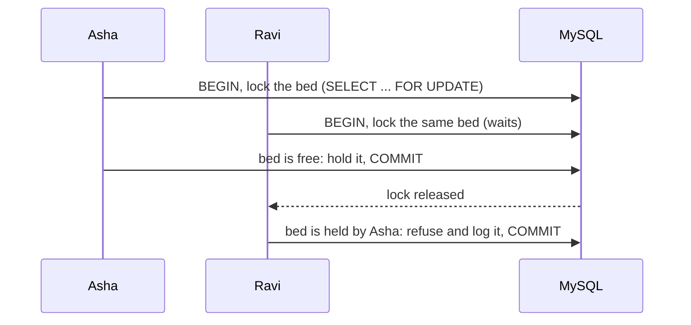
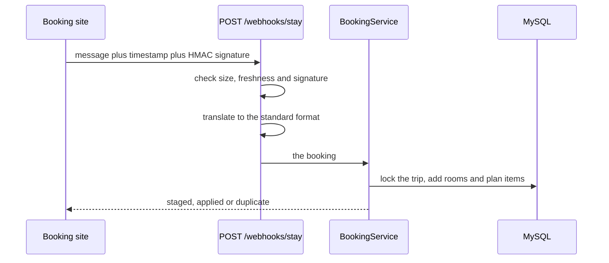

# The Lobby

## Live demo: **https://thelobby-trips.duckdns.org**

Open it on your phone or laptop. It is running right now on AWS.

> **Please note.** The demo runs on AWS free-plan credits, so it is **not guaranteed to stay online**: it may be slow, reset, or switched off without notice. It is a public demo, so **please do not upload anything private** (no real passports or tickets). Test files and trips may be deleted at any time.

**Try it in one minute**

1. On the home page press **Create a trip**, fill in the trip name, your name and the dates (two rooms are already filled in for you), and press **Create trip**. You get a trip code and an invite link.
2. Open the invite link on a phone, or in a private window (a normal second tab shares your login), and join with another name. Tap the **same bed** on both: exactly one wins.
3. Want to see the booking idea? Open the **Demo booking sites** link in the menu, book a hotel, and press **Create a new trip**. The rooms, beds, dates and place fill in by themselves.

(The pages explain themselves as you go. The sections below explain how it is built.)

**A shared space for every group trip.** Everyone sees the plan and claims their place in a live lobby, tickets and passports go in a private vault that deletes itself when the trip ends, and bookings from booking sites fill the trip in for you.

Built with **PHP 8.4, Laravel 13, MySQL 8.4, Blade and jQuery**, and deployed on **AWS** (EC2, RDS, S3). It is deliberately backend-heavy: the interesting parts are concurrency, security and integrations, not screens.

## What it does

- **A live lobby.** Rooms and beds update on every phone within about two seconds. Tapping a bed holds it for a short, configurable time; confirming makes it yours. Two people can never end up on the same bed, even when they tap at the same instant. A confirmed bed can be given back.
- **Holds that expire.** A hold that runs out is released by a scheduled job (and is shown as free even before the job runs).
- **A private vault.** Tickets and passports (PDF or photos) live in a private S3 bucket. Files open only through a 60-second signed link, only for people in the trip, with roles. A removed member loses access at once. When the trip ends (by date, or by the organiser pressing "End trip now") every file is deleted from storage.
- **An audit log.** Every grab, confirm, refusal, removal, file opening and booking change is recorded and can never be edited or deleted. The organiser reads it in plain language.
- **A plan with calendar and maps.** Stays, flights, tickets and meals, with a calendar file (`.ics`) per item or for the whole trip, Google Calendar links, and "Open in maps" links.
- **Booking sites that fill the trip in.** Two pretend booking sites (DemoStay for hotels, DemoFly for flights) stand in for real ones. A booking sent to a trip creates its rooms, beds and plan items, and later changes and cancellations follow by themselves. A trip can even be created straight from a booking. A change never removes a bed someone holds or has confirmed.
- **No accounts, no passwords.** People join with an invite link and a name.

## How it fits together



Everything runs on one small server. The database is not reachable from the internet, the bucket is not reachable without a signed link, and the server has no AWS keys on it (it uses an IAM role).

### Data model



## The hard parts, explained

### No double booking

Each tap is a separate request, and PHP-FPM really runs them in parallel. Without protection two people could both read "bed is free" and both write "bed is mine". The fix is a database row lock:



- Grab, confirm, give up and expire all run in a transaction with `lockForUpdate`. Locks are always taken in the same order (the person first, then the bed), so two people swapping beds cannot deadlock for long; MySQL breaks a deadlock and Laravel retries.
- The database backs the code up: a unique index on `beds.taken_by_member_id` means even a bug could not give one person two beds.
- The refusal is written to the audit log, so a "lost the race" is visible history, not a silent failure.
- `php artisan demo:race <trip-code> --racers=5` proves it live: five separate processes fight for one bed and exactly one wins.

### The vault

- Private bucket (Block Public Access, encryption at rest, HTTPS-only policy). Files are stored under random keys, never under their names.
- A page link goes to the app, which checks the person's membership and role, writes an audit row, and only then redirects to a signed link that lives 60 seconds and is never cached.
- Uploads are limited to 10 MB, 40 files per trip, and PDF or common photo types. The type is checked from the file's content, not its name.
- Roles: the organiser can upload, open and delete files and end the trip; members can upload and open; viewers can only open.
- Self-destruct: a scheduled job ends trips the day after their end date and deletes every file. It is safe to run twice, retries failures every five minutes, and never marks a trip purged while a file is left. The audit log is never deleted.

### Booking sites and the "one standard" idea

Every booking site speaks its own language: one says `check_in` and `rooms`, another says `segments` and `departs_at`. Instead of mixing all of that into the app, each site gets one small translator class, and everything else only ever sees one standard format.



- **Signed webhooks.** The signature is an HMAC-SHA256 of `timestamp.body`, compared in constant time. An old message is refused (stops replays), and nothing in the body is read before the signature is verified.
- **Idempotent.** A unique index on trip, provider and reference, plus the partner's version number: the same or an older message changes nothing.
- **Approval.** A trip code is known to every member, so the first booking pushed to a trip waits for the organiser to press "Add to trip". After that, later versions apply by themselves. (A trip created with "they will come from a booking" takes its first booking at once, because the organiser chose that.)
- **The bed rule.** A change may add rooms and beds and change dates, but never removes a bed that is held or confirmed. That room is kept and the booking shows "Needs attention" with the reason.
- **Adding a site** means writing one class that implements `BookingProvider`, saving a sample message in the tests, and adding one line to the registry. Nothing else changes.

## Security decisions

| Decision | Why |
|---|---|
| No passwords: a 40-character random token in an encrypted, HttpOnly, SameSite cookie; only its SHA-256 hash is stored | A leaked database holds no usable logins; scripts cannot read the cookie |
| Every route checks trip membership and role; services check the role again against the database | The page check is for tidiness, the service check is the real lock (a just-removed organiser is stopped) |
| All input validated server-side with Form Requests | The browser is never trusted |
| Eloquent only, Blade `{{ }}` escaping only | No string-built SQL, no unescaped output |
| Rate limits per person (lobby, vault) and per address (creating and joining trips, webhooks, the demo sites) | Slows guessing and button-mashing |
| Private S3 bucket, signed 60-second links, no AWS keys on the server | A leaked link is useless a minute later; nothing to steal from the machine |
| Database not publicly accessible, reachable only from the web server's security group, and the app connects over TLS with the AWS certificate bundle | Not on the internet |
| Nginx serves only `public/` and runs only `index.php`; `.env`, `.git`, `vendor` and logs return 403 or 404 | Source and secrets are not reachable |
| Webhooks: HMAC signature, fresh timestamp, size limit, strict translators that clean and cap every value | Another company's data is treated as untrusted |
| Audit log is append-only (the model refuses updates and deletes) | History that can be trusted |
| Errors are logged in full but users only see a friendly page; `APP_DEBUG=false` in production | No internals leaked |
| PHP 8.4.27 or newer | Includes the fix for a published PHP vulnerability |

## Run it on your computer

You need **PHP 8.3.36+, 8.4.27+ or 8.5.12+** (with the usual extensions: curl, fileinfo, mbstring, openssl, pdo_mysql, zip, intl), **Composer** and **MySQL 8.4**.

```bash
composer install
cp .env.example .env          # on Windows PowerShell: Copy-Item .env.example .env
php artisan key:generate
```

Create two empty databases (one for the app, one for the tests) and a user:

```sql
CREATE DATABASE thelobby;
CREATE DATABASE thelobby_test;
CREATE USER 'thelobby'@'localhost' IDENTIFIED BY 'choose-a-password';
GRANT ALL ON thelobby.* TO 'thelobby'@'localhost';
GRANT ALL ON thelobby_test.* TO 'thelobby'@'localhost';
```

Put the same password in `DB_PASSWORD` in `.env`, then:

```bash
php artisan migrate
php artisan serve                  # the app, at http://127.0.0.1:8000
php artisan schedule:work          # in a second terminal: expires holds, purges vaults
```

Everything works locally except the **vault**, which needs a private S3 bucket (`AWS_BUCKET`, `AWS_DEFAULT_REGION` and credentials in `.env`). Tests use a fake S3, so they need no AWS account.

### Settings (`.env`)

| Key | Meaning |
|---|---|
| `HOLD_SECONDS` | How long a tapped bed is held (120 by default; use 30 for a quick demo) |
| `ADMIN_KEY` | Password for the owner-only error page (at least 16 characters; empty switches it off) |
| `SESSION_SECURE_COOKIE` | `true` once the site is on HTTPS |
| `AWS_BUCKET`, `AWS_DEFAULT_REGION` | The vault's bucket (credentials only on a laptop; on AWS the server uses a role) |
| `DEMO_PARTNERS` | `false` switches the pretend booking sites off completely |
| `PARTNER_STAY_SECRET`, `PARTNER_FLY_SECRET` | Webhook secrets. Leave empty for the pretend sites (derived from `APP_KEY`) |

## Tests and checks

```bash
php artisan test                                   # 231 tests, against a real MySQL (thelobby_test)
php vendor/bin/pint app tests config routes        # code style
php artisan demo:race <trip-code> --racers=5       # five processes fight for one bed
php scripts/smoke-test.php <site-url> --quick      # the whole thing, over real HTTP
```

The smoke test behaves like real people against a running copy: it creates a throw-away trip, joins five people, fires five simultaneous grabs at one bed (exactly one may win), uploads to the vault and opens the signed link, books a pretend hotel, approves it, changes and cancels it, tries forged webhooks, starts trips from bookings, and ends the trip. It finishes with `ALL PASSED`.

## Project layout

```
app/
  Services/        the rules: BedService, VaultService, BookingService, TripService, WebhookReceiver ...
  Integrations/    the standard booking format, the translators, the registry
  Http/            thin controllers, Form Requests, middleware (login, roles)
  Models/          Trip, Member, Room, Bed, VaultFile, AuditLog, Booking, ItineraryItem ...
  Support/         calendar files, map links, audit wording, login tokens
  Console/Commands scheduled jobs and demo commands
resources/views/   Blade pages        public/js, public/css   small scripts and one stylesheet
database/migrations/                  every schema change, never hand-edited
deploy/            server set-up, release, HTTPS and settings scripts
docs/              RUNBOOK.md (operate it), BUILD_LOG.md (how it was built, errors and lessons)
scripts/           smoke test and local helpers
tests/             231 tests (concurrency, roles, vault, webhooks, translators)
```

## Deploying to AWS

The repeatable scripts are in `deploy/`; the full step-by-step with every error met along the way is in [docs/BUILD_LOG.md](docs/BUILD_LOG.md), and day-to-day operating instructions are in [docs/RUNBOOK.md](docs/RUNBOOK.md).

1. **Network:** two security groups. The web group allows SSH from your address only, plus ports 80 and 443. The database group allows port 3306 from the web group only.
2. **Database:** RDS MySQL 8.4, small instance, private, TLS with the AWS certificate bundle.
3. **Storage:** a private S3 bucket (Block Public Access, encryption, HTTPS-only policy, a 30-day lifecycle rule as a safety net).
4. **Permissions:** an IAM role for the server limited to that bucket's `trips/*` prefix, so no keys are stored on the machine.
5. **Server:** Ubuntu 24.04 on EC2. `deploy/setup-server.sh` installs PHP, Nginx and Composer, clones the repo, and writes the production `.env`. `deploy/create-db-user.sh` creates a limited database user. `deploy/release.sh` ships new code (pull, install, migrate, cache).
6. **HTTPS and a name:** a free DuckDNS name and a Let's Encrypt certificate (`deploy/enable-https.sh`), renewed automatically.
7. **Background jobs:** one cron line runs `schedule:run` every minute.

It was built to stay within the AWS Free plan and its credits. That is not free forever: the instance, the database and the fixed IP address all cost credits while they exist, so a teardown checklist is in the runbook.

## Demo script (about five minutes)

1. Create a trip, then open the invite link on a phone or in a private window and join as someone else.
2. Race: run `demo:race` against the trip (or tap the same bed on two phones). Exactly one wins, and the other is told why.
3. Confirm a bed, give it up, watch the other phone update.
4. Open the vault, upload a PDF, open it, and show that the link dies after a minute.
5. Open the Activity page and read the story of what just happened, including the refused grab.
6. Open the demo booking sites, book a hotel, and press "Create a new trip". The rooms, beds, dates and place appear by themselves, and the calendar and map links work.
7. Change the booking on the hotel site and watch the trip follow. Reduce the rooms while someone is in the last one: the room stays and the booking shows "Needs attention".

## Known limitations

- **One server and one database.** There is no standby; backups are daily. Fine for a demo, not for a business.
- **Polling, not websockets.** Each open lobby asks for fresh state about every two seconds. Simple and robust, and fine for a group, but it would not scale to thousands of people watching.
- **Third-party name.** The free DuckDNS name depends on a third party; the raw IP address works as a fallback.
- **Booking sites are pretend.** Real sites cannot be connected to; the demo shows the design (one standard format, one translator per site, signed webhooks), not a partnership.
- **Trip times have no time zone.** "14:00" means 14:00 at the place.
- **Trip-code exposure window.** For a trip waiting for its first booking, anyone who knows the code could send that first booking, so the organiser is told to keep the code private until it arrives.
- **Plan items cannot be edited in place.** Remove and add again (booking items update themselves).
- **File names stay in the database and audit log after a purge** (the files themselves are deleted).
- **The 30-day bucket rule counts from upload,** so very long trips rely on the app's own purge, not the safety net.
- **The local database does not start by itself** after a reboot.

## Roadmap

- Email or SMS notifications when a bed is taken or a booking changes (SNS).
- QR code on the invite.
- Edit plan items in place; a per-trip time zone.
- Claimable flight seats, using the same locking as beds.
- More booking sites, with AI-assisted drafting of translators from a sample message (reviewed by a person, then covered by a saved-sample test).
- A standby database in a second zone, CloudWatch alarms, an "always HTTPS" header (HSTS), and infrastructure as code.

## Credits and licence

Built on [Laravel](https://laravel.com) (MIT). No licence has been chosen for this project yet.
